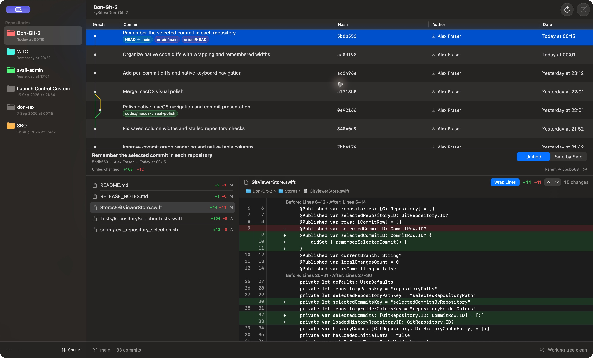
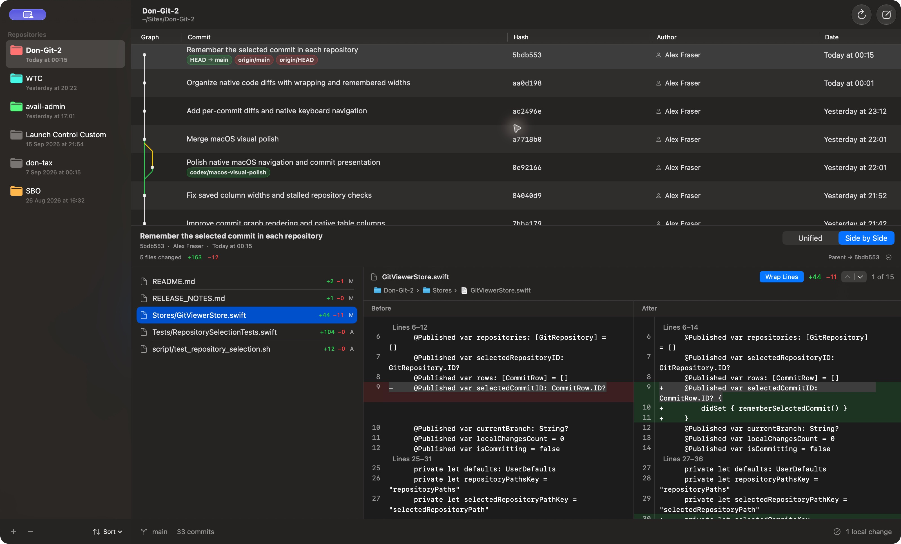
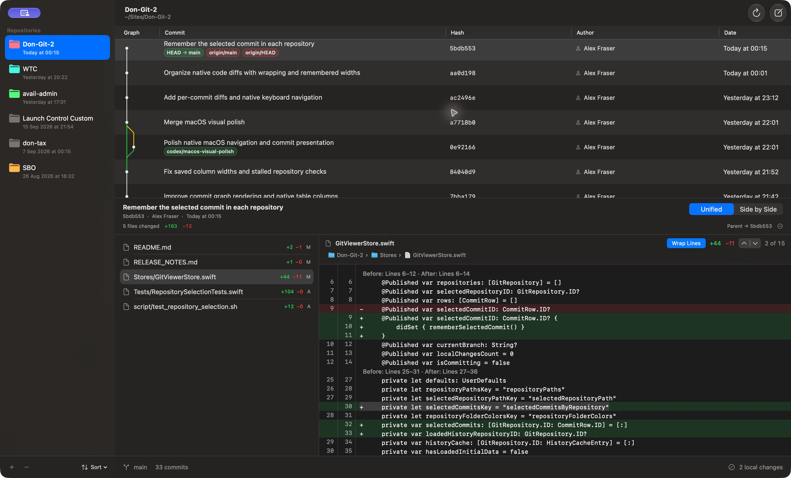

# Don Git 2

**Native commit review, built for macOS.**

Explore your Git repositories, follow current origin branch positions, and review both uncommitted edits and saved commits. Don Git 2 uses SwiftUI, AppKit, and standard macOS controls, with keyboard navigation and a workspace that remembers where you left off.



## New in the latest update

| Feature | What it does |
| --- | --- |
| **Uncommitted changes** | Review staged edits, unstaged edits, and new files from a clearly marked row above the commit history. Local previews refresh every three seconds. |
| **Current origin branches** | Fetch origin automatically on opening a repository, returning to the app, and every minute, with visible check progress and freshness. |
| **Changes per commit** | Select a commit to see its changed files, full message, and addition/deletion counts. |
| **Two diff views** | Review one unified diff or compare before and after side by side, with synchronised vertical scrolling. |
| **Keyboard navigation** | Move between repositories, commits, files, and changed blocks using native focus and shortcuts. |
| **Wrap Lines** | Fit long code to the pane while keeping side-by-side rows aligned. Your choice is remembered. |
| **Remembered workspace** | Restore column widths, pane sizes, and the last selected commit in each repository, including after restarting. |

See the [changelog](RELEASE_NOTES.md) for the full update.

## Read the changes, in context

A compact file toolbar keeps **Wrap Lines**, change counts, and previous/next controls close to the code. Native path breadcrumbs show where the file belongs; fixed line-number gutters and plain line ranges help you follow the diff. Select and copy code using the standard macOS text controls.



Compare merge commits against either parent, and root commits against an empty tree. Renames, deletions, additions, binary files, and metadata-only changes have explicit representations.

## Stay in the flow

Select **Uncommitted Changes** at the top of the history to review staged edits, unstaged edits, and new files before committing. The hollow graph node and **Not committed** label distinguish the working tree from saved commits. A dotted line connects it to HEAD, bypassing newer commits on other branches. Its file list and unified or side-by-side diff compare the current working copy with HEAD, including additions, deletions, renames, and binary files.

Local changes refresh every three seconds while preserving the selected file. Origin checks run separately so a slow connection does not hold up local previews. Reviewing changes leaves your index and files unchanged. Repositories without a first commit compare against an empty tree; committing removes the uncommitted row and selects the new commit.

Click the sidebar, commit history, or changed-file list to focus it. The selected row uses the native blue accent highlight on the pictured system, and arrow keys move through that list. The **Navigate** menu provides shortcuts for moving between panes and changes.

| Action | Shortcut |
| --- | --- |
| Focus repositories / history / changed files / code | ⌘0 / ⌘1 / ⌘2 / ⌘3 |
| Previous / next commit | ⌃⌘↑ / ⌃⌘↓ |
| Previous / next changed file | ⌥⌘↑ / ⌥⌘↓ |
| Previous / next changed block | ⌥⌘← / ⌥⌘→ |
| Add repository | ⌘O |
| Refresh history | ⌘R |
| Submit the commit sheet | ⌘Return |



Switch repositories and return to the commit you were reviewing. Resized history columns and pane dividers also survive app restarts.

## A familiar macOS workspace

- Add repositories through the standard macOS folder picker; any folder inside a Git working tree is accepted.
- Give repository folders persistent colours and sort by name or most recent commit date.
- Follow the routing and order of `git log --graph --oneline --decorate --all`, with branch, remote, and tag badges.
- Read local branch badges beside their matching origin badges, with the current branch first. Tags and unmatched remote refs stay separate.
- Distinguish local and remote branches with subtle system green and red tints that adapt to light, dark, and increased-contrast appearances.
- Spot linked worktrees by the folder icon inside local branch badges; a house icon identifies the main checkout. Hover for the checkout type and folder path; markers refresh as worktrees change.
- Read continuous coloured lanes, curved joins, and outlined merge nodes in both light and dark appearances. Crossings stay separate from parent junctions.
- Graph lines share a drawing layer above the native rows, spanning their measured spacing without breaks when scrolling, selecting commits or resizing columns.
- Read the current branch, commit count, and working-tree status in the bottom bar.
- Automatically fetch origin when opening a repository, returning to the app, and every minute. The graph shows the latest fetched origin branch positions, including new branches, force-pushes, and deletions.
- Check origin immediately with **Refresh History** (⌘R). The bottom bar shows the last successful check, progress, or a connection/authentication failure; existing history stays available offline.
- Origin checks only update remote-tracking branches and download history. They never pull, merge, switch branches, or alter local files. Repositories without origin continue to work locally.
- Stage and commit all local changes from a multiline commit sheet.

Choose **System**, **Light**, or **Dark** in **Don Git 2 → Settings…** (⌘,). The choice applies immediately throughout the app and is remembered across launches. System follows your Mac’s appearance.

Drag the **Graph** column divider to widen it for dense histories. An ellipsis marks rows with lanes outside the current column width.

Read connections downward from each commit to its parents. Git groups branch history and keeps children above their parents; commit dates can therefore appear out of sequence between branches.

The interface follows native macOS conventions, including the macOS 26 / Golden Gate toolbar treatment, while retaining macOS 15 support.

## Build and run

Requires **macOS 15 or later**, **Swift 6.1 or later**, and Git available at `/usr/bin/git`.

```bash
git clone https://github.com/alexff8505/Don-Git-2.git
cd Don-Git-2
bash script/build_and_run.sh
```

The packaged app is written to `dist/Don Git 2.app`. Use `bash script/build_and_run.sh --build` to package without launching, or `swift build` to compile only.

## Checks

The focused checks cover origin refresh, uncommitted changes and index preservation, Git history and diffs, native rendering, column persistence, and repository selection memory:

```bash
bash script/test_graph.sh
bash script/test_graph_overlay.sh
bash script/test_changes.sh
bash script/test_diff_view.sh
bash script/test_columns.sh
bash script/test_repository_selection.sh
bash script/test_origin_refresh.sh
bash script/test_local_changes.sh
bash script/test_worktrees.sh
```

To check every rendered parent connection in an existing repository, pass its path to `script/test_graph.sh`. This reads the repository without modifying it. Graph checks also compare ordering with the reference Git command, exercise real merges with up to four parents and interleaved roots, and measure native palette contrast.

[Changelog](RELEASE_NOTES.md) · [Screenshot gallery](Docs/Screenshots/README.md)
